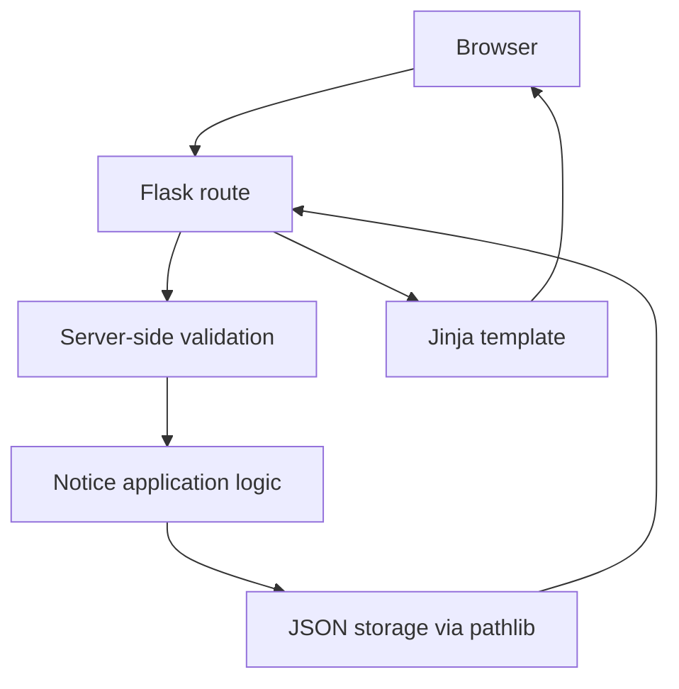

# Architecture

The application is a small local Flask site. A browser sends a request to a Flask route; routes validate user input, call the JSON persistence functions, and return a rendered page or redirect.

## Main routes

| Route | Method | Purpose |
|---|---|---|
| `/` | GET | List notices; category and location query parameters filter the displayed results. |
| `/notice/<id>` | GET | Display one notice's details. |
| `/create` | GET | Show the new notice form. |
| `/create` | POST | Validate and save a notice, then redirect to its detail page. |
| `/notice/<id>/resolve` | POST | Mark an existing notice resolved, then redirect to its detail page. |

The persistence module, `database.py`, reads and writes `data/notices.json`. It uses an atomic temporary-file replacement when saving. Malformed JSON raises a controlled storage error; the app logs technical details and displays a generic error page. The Flask development server binds to `127.0.0.1` and runs with debug mode disabled.
